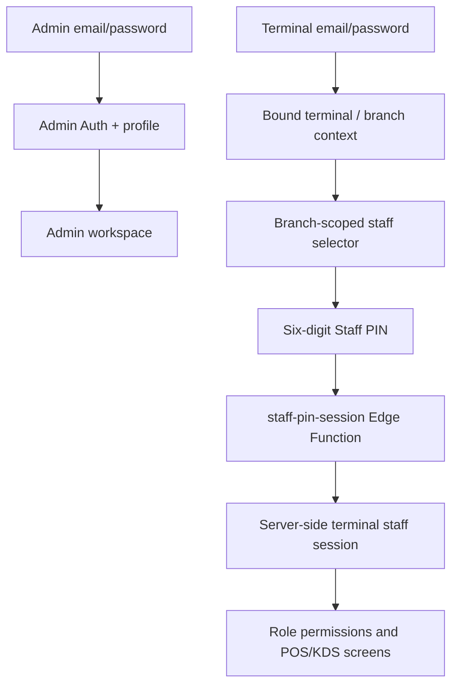

# Authentication and Session Flow

## Implemented model

The current login path gives administrators and terminals separate Supabase Auth identities and uses PIN-based `public.staff` records for operators. Historical orders, payments, and audit records still refer to legacy `profiles` keys. End-to-end separation across every POS path remains under verification.

## Current controls

- Admin sign-in requires an active ADMIN profile. Terminal sign-in requires `pos_terminals.auth_user_id` to be bound to an active, registered terminal.
- `resolve_authenticated_terminal` and `list_authenticated_terminal_staff` resolve the terminal and branch from terminal Auth and active device proof. A browser device identifier is used during activation; it is not the device credential.
- `staff-pin-session` validates the selected `staff` record's six-digit PIN on the server. It never creates, exchanges, or returns a staff Auth token.
- `terminal_staff_sessions` records the terminal Auth session plus `staff_record_id`, role, permissions, lifecycle, and activity timestamps. Legacy `staff_id` remains for historical foreign-key compatibility.
- Idle lock calls the terminal session lock flow; switching staff ends the operator session before selection resumes.
- Manager approval is action-scoped in order/discount flows and uses server-side PIN verification. It does not intentionally elevate the requester permanently.

## Remaining verification

The Admin function manages `public.staff` records and returns a one-time PIN; it does not create staff email/password credentials. This local review did not verify the staging deployment. Admin-route negative authorization and full cashier browser coverage are still required before a production release decision.
