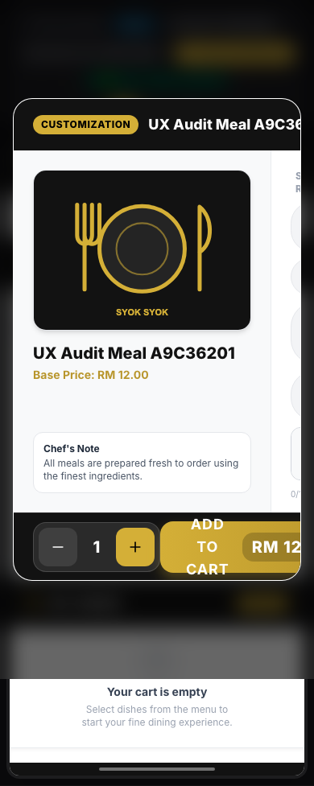
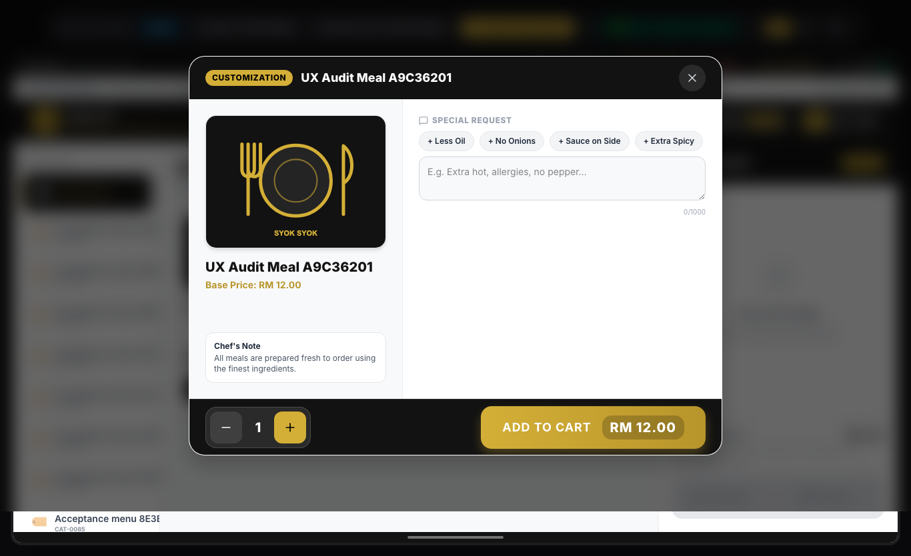

# Before/after screenshot comparison register

**PARTIALLY VERIFIED** — before screenshots are actual local renders. After screenshots are **NOT VERIFIED** and will be added only after approved implementation; no proposed mockup is presented as a completed change.

| Area | Actual before | Planned comparison / acceptance | After |
|---|---|---|---|
| Login | [1366px](evidence/auth-fullscreen-1366-settled.png) | Same viewport; accurate environment; consistent identity | NOT VERIFIED |
| Dashboard | [1366px](evidence/admin-dashboard-1366-settled.png) | Existing operational metrics before setup shortcuts | NOT VERIFIED |
| Staff table | [390px](evidence/admin-users-390-settled.png) | Key fields and detail/actions discoverable | NOT VERIFIED |
| Mobile navigation | [390px](evidence/admin-mobile-nav-390-settled.png) | Clear groups; keyboard dismissal and focus containment | NOT VERIFIED |
| Product menu | [1366px](evidence/pos-menu-1366-settled.png) | Product density and visible order access | NOT VERIFIED |
| Product options | [1366px](evidence/pos-customization-1366-settled.png), [390px](evidence/pos-customization-390-settled.png) | All modifiers, quantity and Add to Cart reachable | NOT VERIFIED |
| Cart portrait | [768px](evidence/pos-cart-768-settled.png) | Remove excessive blank item height; coherent summary/action | NOT VERIFIED |
| Payment phone | [390px](evidence/pos-payment-390-settled.png) | Amount due/tender/action hierarchy; associated labels | NOT VERIFIED |
| Serving | [Empty queue, 1366px](evidence/pos-serving-1366-settled.png) | Empty and populated states, reconnect and actions | NOT VERIFIED |
| Kitchen-role landing | [Actual welcome screen, 1366px](evidence/pos-kitchen-1366-settled.png) | Investigate role landing before queue comparison | NOT VERIFIED |

Images are from local fixture data. Raw captures, JSON metrics, contact sheets and capture scripts are in `test-results/uiux-audit-2026-10-12/`. The filename `pos-kitchen` denotes the logged-in role: the image is a welcome screen, not a rendered kitchen queue. Original non-settled role captures showed PIN-saving states and must not be used as queue evidence.

## Highest-priority before evidence

### Product options on a phone

### Product options on a laptop

Compare after images with identical viewport, role, screen state and representative content. Keep monetary values supplied by existing calculations. Supplement images with keyboard and interaction evidence; appearance alone cannot verify transaction behavior.

## 13 October after captures

| Surface | Before | After | Comparison scope |
|---|---|---|---|
| Dashboard, 1366 | [Before](../../../test-results/uiux-audit-2026-10-12/admin-dashboard-1366-settled.png) | [After](evidence/after-admin-dashboard-1366.png) | Authenticated local pages; different disposable data |
| Dashboard, phone | [Before](../../../test-results/uiux-audit-2026-10-12/admin-dashboard-390-settled.png) | [After](evidence/after-admin-dashboard-390.png) | Full viewport shell and compact session actions |
| Modifier, phone | [Before](../../../test-results/uiux-audit-2026-10-12/pos-customization-390-settled.png) | [After](evidence/modifier-after-390.png) | Before live fixture / after controlled component fixture; content differs |
| Payment, phone | [Before](../../../test-results/uiux-audit-2026-10-12/pos-payment-390-settled.png) | [After](evidence/payment-after-390.png) | Before local flow / after controlled UI fixture; not settlement evidence |
| Admin navigation | [Before](../../../test-results/uiux-audit-2026-10-12/admin-mobile-nav-390-settled.png) | [After](evidence/after-admin-navigation-390.png) | Keyboard-contained navigation |
| Cart, phone | [Before](../../../test-results/uiux-audit-2026-10-12/pos-cart-390-settled.png) | [After](evidence/cart-after-390.png) | Wrapping rows, touch targets, removed empty minimum height |

These are design comparisons, not identical-data pixel regression tests. All five-size component captures and the 24 admin page captures are under [modernization evidence](../../../test-results/uiux-modernization/). Kitchen after captures use explicit component fixtures; they do not replace missing live role-landing acceptance.

Additional after captures: [phone menu](evidence/menu-after-390.png), [staff welcome](evidence/welcome-after-390.png), [kitchen component fixture](evidence/kitchen-after-390.png).
